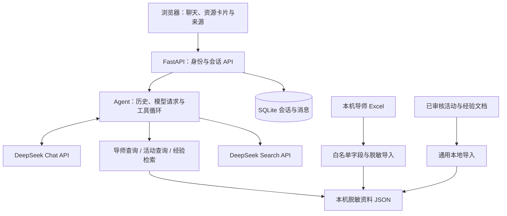

# 启程 · 学生职业发展智能体

一个以自然语言理解学生需求、匹配导师与活动、检索经验资料的 Web 原型。后端直接调用 DeepSeek 官方 API，通过受控工具执行查询；前端提供聊天、资源卡片、来源查看和历史记录。

本仓库只包含源码、字段模板、测试及文档。**导师表、活动与文档数据、样例资料文件、聊天记录、密钥、邀请码和运行日志均不上传。** 首次克隆得到空资源库，需要按下文单独准备资料；不要把源码仓库当作数据备份。

## 当前能力与边界

| 模块 | 已实现 | 当前边界 |
|---|---|---|
| 对话 | DeepSeek 多轮对话、必要追问、流式回复、工具执行状态 | 没有跨会话长期画像，也没有独立任务状态机 |
| 导师匹配 | 专用 Excel 脱敏导入、行业/城市/岗位及学科关键词匹配、搜索与分页 | 匹配依据是概括背景，不代表导师的指导承诺、可约状态或名额 |
| 导师资料 | 按 `mentor_id` 隔离经验检索、独立导师会话、来源展示 | 真实导师仅有名单时不开放数字导师；需要另行导入经授权的经验文档 |
| 活动 | 结构化资源卡片、活动时间和报名截止过滤 | 不自动采集公众号；资料需先核验后导入 |
| 联网补充 | DeepSeek Search，展示外部来源 | 不用公开搜索推断内部预约状态或还原脱敏导师身份 |
| 会话与访问 | 邀请码、浏览器身份隔离、SQLite 持久化、基础限流 | 不是正式校园账号系统，没有跨设备登录 |
| 网站 | 电脑/手机响应式页面、历史记录、停止生成和错误提示 | 没有运营后台、收藏/反馈统计或已发布小程序 |

尚未实现真实预约/报名提交、审核和取消流程；系统只能说明已有信息并帮助准备咨询问题。语音、视频数字人、PDF/Word/OCR 解析、向量或混合检索、长期服务器部署也不在当前实现中。

参考项目的检索管线和小程序端已做过架构评估，但未合并进本仓库。

## 架构与目录

采用 **FastAPI + 原生 HTML/CSS/JavaScript + SQLite + 本地 JSON 资料 + DeepSeek API**。没有依赖 Dify、LangGraph，也不需要单独运行前端构建服务。



```text
.
├── app/
│   ├── main.py             # HTTP API、Cookie、限流、流式输出
│   ├── agent.py            # 工具定义、模型循环、外部搜索、离线规则模式
│   ├── catalog.py          # 数据加载、字段投影、匹配与关键词检索
│   ├── mentor_excel.py     # Excel 脱敏、稳定标识、原表行号映射
│   ├── storage.py          # SQLite 会话与消息
│   └── config.py           # 环境配置、API Key 与本机密钥加载
├── web/                    # 同源静态网页，无外部 CDN 依赖
├── templates/              # 字段模板，不含实际业务资料
├── tests/                  # 合成资料与模拟模型响应的测试
├── import_mentor_excel.py  # 导师 Excel 专用导入命令
├── import_data.py          # 已审核 CSV/JSON/Markdown 导入
├── requirements.txt        # 运行依赖
├── requirements-dev.txt    # 测试依赖
├── requirements.lock.txt   # 开发环境全部依赖快照
├── run.sh                  # macOS/zsh 启动入口
├── data/                   # 本机资料目录，不上传
└── runtime/                # 本机状态、数据库、密钥与日志，不上传
```

下文所有相对路径均相对于仓库根目录。

## 快速启动

需要 **Python 3.11 或以上**。示例使用 `python3.11`，可以替换为本机已安装的更高版本。代码使用 `asyncio.timeout`，macOS 自带的旧版 Python 可能不满足要求。

```sh
python3.11 -m venv .venv
.venv/bin/python -m pip install -r requirements.txt
```

### 无密钥体验界面

```sh
SRT_MODE=sample .venv/bin/python -m uvicorn app.main:create_app \
  --factory --host 127.0.0.1 --port 8000 --no-access-log
```

打开 `http://localhost:8000`。`sample` 是明确标注的离线规则模式，不调用 DeepSeek，不代表真实大模型效果。没有配置资料时，页面资源列表为空；该模式不会自动生成或下载导师/活动数据。

默认首次启动会生成邀请码，可以在本机另一个终端查看：

```sh
cat runtime/access_code
```

邀请码应通过团队认可的私下渠道提供给测试者，不写入 README 或 Git。若使用 `SRT_ACCESS_CODE` 覆盖，实际邀请码以该环境变量为准，`runtime/access_code` 可能不存在或保留旧值。

### 使用真实 DeepSeek

先停止离线服务，配置自己的 API Key，再启动：

```sh
export DEEPSEEK_API_KEY='替换为你自己的密钥'
.venv/bin/python -m uvicorn app.main:create_app \
  --factory --host 127.0.0.1 --port 8000 --no-access-log
```

也可以把 Key 留在独立的本机文件中，只指定路径：

```sh
export DEEPSEEK_API_KEY_FILE='/本机私密目录/deepseek-key'
.venv/bin/python -m uvicorn app.main:create_app \
  --factory --host 127.0.0.1 --port 8000 --no-access-log
```

在 macOS/zsh 中，已建立 `.venv` 后可用 `./run.sh` 启动。该脚本默认监听 `0.0.0.0:8000`，允许其他可达设备连接；只需本机访问时运行 `SRT_HOST=127.0.0.1 ./run.sh`。直接执行 Uvicorn 时，应通过命令参数指定主机和端口。

真实模式缺少 Key 会启动失败；模型请求失败会返回明确错误，不会自动用离线答案冒充。模型名可配置，实际账户权限、额度和模型可用性需由部署者验证。

### 环境变量

| 变量 | 默认值 | 作用 |
|---|---|---|
| `SRT_MODE` | `deepseek` | `deepseek` 为真实模型；`sample` 为离线规则演示 |
| `DEEPSEEK_API_KEY` | 空 | 非空时优先使用，始终只在服务端读取 |
| `DEEPSEEK_API_KEY_FILE` | 仓库上级目录的 `api_key` | 没有环境 Key 时读取；支持原始 `sk-…` 值或可识别的单密钥文本 |
| `DEEPSEEK_MODEL` | `deepseek-flash` | Chat API 的模型名称 |
| `SRT_ACCESS_CODE` | 自动生成并保存 | 测试邀请码；设置时至少 8 个字符 |
| `SRT_DATA_DIR` | 仓库下 `runtime/` | **运行状态目录**：数据库、邀请码和会话签名密钥；不改变业务资料的 `data/` 位置 |
| `SRT_WEB_SEARCH` | `1` | 真实模式且值为 `1` 时启用搜索；设为 `0` 关闭 |
| `SRT_HOST` | `0.0.0.0` | 仅供 `run.sh` 使用的监听地址 |
| `SRT_PORT` | `8000` | 仅供 `run.sh` 使用的监听端口 |

程序不自动加载 `.env`；请在启动环境中设置变量，或由部署系统注入。`max_rounds` 是 `Settings` 中的代码配置，当前为 5，不是已开放的环境变量。

## 数据存放位置与恢复方式

以下文件均不属于上传的源码内容。**仅克隆仓库不能恢复原部署的资料或聊天记录。** 数据必须通过授权的数据交接单独准备。

| 本机位置 | 内容 | 创建/恢复方式 |
|---|---|---|
| `../第六期导师总表.xlsx` | 原始导师工作簿，建议放仓库外 | 运营人员单独提供；CLI 接受其他路径，不依赖这个文件名 |
| `data/imported_mentors.json` | 专用导入器生成的脱敏导师目录和统计 | 用原表运行 `import_mentor_excel.py --write` |
| `data/imported_catalog.json` | 经审核的活动、导师资料文档等 | 运行 `import_data.py` |
| `data/sample_catalog.json` | 可选虚构样例，包含 `mentors/activities/documents` | 需要时在本机自行准备；仓库不分发该数据集 |
| `runtime/sessions.sqlite3` | 会话、用户归属、消息、来源与资源卡片 | 启动自动创建；需要保留历史时单独备份和恢复 |
| `runtime/sessions.sqlite3-wal`、`-shm` | SQLite WAL 相关状态 | 由 SQLite 管理；备份时使用一致性备份或停止服务后操作 |
| `runtime/access_code` | 默认邀请码 | 首次启动生成；可用环境变量覆盖 |
| `runtime/session_secret` | Cookie 身份签名密钥 | 首次启动生成；更换后旧 Cookie 失效 |
| `runtime/mentor_identity_secret` | 导师稳定标识的 HMAC 密钥 | 导师写入导入时生成；同一数据集重导时保留 |
| `runtime/mentor_source_map.json` | 脱敏 ID → 原表工作表和行号 | 导入生成，仅供本机运营人员回查，不包含原始姓名和联系方式 |
| `runtime/server.log`、`tunnel*.log` | 服务或隧道启动日志 | 由相应启动方式生成，普通 `run.sh` 默认输出到终端 |
| `runtime/server.pid`、`tunnel.pid`、`caffeinate.pid` | 本机进程记录 | 由手工后台管理方式生成，不是可跨机器复用的配置 |
| `runtime/public_access.json`、`tunnel_current_log` | 临时公网地址与检查记录 | 本机运维记录；更换隧道后需更新，应用本身不读取它们 |
| `../api_key` 或配置指定路径 | DeepSeek Key | 单独安全配置，不上传 |

若设置 `SRT_DATA_DIR`，前三项业务资料路径仍保持在仓库的 `data/` 中，应用运行状态则写到指定目录。导师导入 CLI 有独立的 `--runtime-dir` 参数，不会自动读取 `SRT_DATA_DIR`；若需要统一目录，应显式传入同一路径。

资源在 `Catalog` 初始化时读取，**修改/导入资料后需要重启服务**。会话数据在运行时写入 SQLite。不要删除 `mentor_identity_secret` 后重新导入相同名录，否则导师 ID 会变化；脱敏称呼中的显示编号按导入顺序生成，也不能当作永久业务 ID。

### 导师 Excel 专用脱敏导入

```sh
# 默认预检：只输出统计，不写导师目录
.venv/bin/python import_mentor_excel.py '../第六期导师总表.xlsx'

# 写入脱敏目录和本机回查映射
.venv/bin/python import_mentor_excel.py '../第六期导师总表.xlsx' --write
```

可选参数：

```text
--output PATH       默认 data/imported_mentors.json
--runtime-dir PATH  默认 runtime/，存放导师标识密钥和原表行号映射
--write             明确执行写入；不提供时只做预检
```

`--output` 改到别处不会让网站自动加载新位置；网站仍读取 `data/imported_mentors.json`。导入不自动重启服务。

导入器处理不超过 10 MB 的工作簿，选取首个同时包含“行业分组”“姓名”表头的工作表；合并单元格形成的行业分组向下填充，忽略其他排序表或志愿者表。它按原名和单位的 HMAC 标识去重，但不保存原名或单位；内部 ID 稳定依赖相同原始身份和密钥。

公开产物只含：姓氏＋导师编号、固定白名单行业、城市/省级地区、机构类型、概括岗位类别、学科领域、来源及状态。账号、密码、电话、邮箱、完整姓名、精确单位与职务、志愿者关系、入学年份等不写入公开数据。无法可靠映射的字段保留为“待补充/未公开”。导入目录、标识密钥与行号映射以 `0600` 文件权限保存。

只有名单不代表已有数字导师或可预约时段；专用导入器默认设置 `has_digital_mentor=false`、`available=false`。岗位和学科归类是程序规则结果，需要运营人员检查，不等于导师声明的服务能力。

### 已审核活动和文档导入

```sh
.venv/bin/python import_data.py '/本机已审核资料/activities.csv' '/本机已审核资料/experience.md'
```

| 格式 | 识别/必填要求 |
|---|---|
| CSV | 有 `name` 列时按导师处理；否则有 `start_at` 列时按活动处理。每条导师需 `name`，活动需 `title` |
| JSON | 顶层对象包含 `mentors`、`activities`、`documents` 中至少一个非空数组；导师需 `name`，活动需 `title`，文档需 `mentor_id` 与 `text` |
| Markdown | 以 `---` 包围的简单 `key: value` 元数据开头，必须有 `mentor_id`，正文非空；标题默认使用文件名 |

通用导入读取 UTF-8/UTF-8 BOM 文本，每文件最大 2 MB，按 ID 更新，错误文件单独记录；成功记录写入 `data/imported_catalog.json`。未提供 ID 时会从内容生成；显式 ID 只允许 1—100 位字母、数字、下划线和连字符。日期字段使用 ISO 日期时间；标签数组或使用 `|`、逗号、分号分隔的文本均可。URL 只保留 HTTP/HTTPS。

模板见 `templates/`，仅用于说明列结构，导入前应替换占位内容并审核。**真实导师工作簿必须走专用脱敏导入器**；通用导入不会自动把任意正文、标题或描述脱敏，也不执行授权审核。

三类资料的本机 JSON 结构均以集合为基础：

```json
{
  "mentors": [],
  "activities": [],
  "documents": []
}
```

空结构说明数据形状，不是可导入的业务资料；通用 CLI 要求至少一条有效记录。导师专用文件另外带 `import_report` 统计。

- 导师常用字段：`id, name, title, subtitle, description, industry, city, organization_type, role_family, education_domains, tags, has_digital_mentor, available, booking_method, source_label, url`。
- 活动常用字段：`id, title, description, tags, audience, organizer, start_at, end_at, registration_deadline, location, status, source_label, url`。`status` 支持 `unknown/open/active/registration_open/closed/ended/cancelled/canceled/inactive`。
- 文档常用字段：`id, mentor_id, title, text, tags, source_label, url`。`mentor_id` 必须对应目标导师，当前导入器不会自动核查关联导师是否存在。

有真实导师时，默认目录和经验查询隐藏虚构导师及其文档；明确指定的旧样例导师会话仍可读取对应样例资料。导师专用文件中的同 ID 记录优先于通用文件；通用文件同 ID 记录优先于样例文件。原始数据文件不通过静态服务暴露。

## 全部 HTTP 接口

API 与网站同源。除页面、静态文件、状态和登录外，接口均要求有效 Cookie。JSON 请求使用 `Content-Type: application/json`；聊天成功响应是 NDJSON，不能用一次 `response.json()` 读取。

| 方法 | 路径 | 是否登录 | 用途 |
|---|---|---|---|
| GET | `/` | 否 | 返回网站 HTML |
| GET | `/static/{path}` | 否 | 返回 `web/` 下的静态资源 |
| GET | `/favicon.ico` | 否 | 返回 204，无图标正文 |
| GET | `/api/status` | 否 | 模式、身份状态及资料数量 |
| POST | `/api/login` | 否 | 校验邀请码并设置 Cookie |
| GET | `/api/resources` | 是 | 全部可展示导师与活动 |
| GET | `/api/sessions` | 是 | 当前浏览器身份最近 100 个会话 |
| POST | `/api/sessions` | 是 | 创建主助手或指定导师会话 |
| GET | `/api/sessions/{session_id}` | 是 | 会话元数据与消息历史 |
| POST | `/api/chat` | 是 | 在指定会话发送消息，返回流式事件 |

`/docs`、`/redoc`、`/openapi.json` 已关闭。当前没有上传、删除会话、登出、预约、报名或管理后台 API；内部查询工具也不是可直接调用的 HTTP 端点。

### GET /api/status

无需请求体。返回字段：

```json
{
  "mode": "deepseek",
  "model": "deepseek-flash",
  "sample_data": false,
  "authenticated": false,
  "web_search_enabled": true,
  "data_summary": {
    "mentor_count": 0,
    "real_mentor_count": 0,
    "sample_mentor_count": 0,
    "activity_count": 0,
    "sample_activity_count": 0,
    "mentor_documents_count": 0,
    "privacy_mode": "sample"
  }
}
```

该例表示空资源库。`sample_data` 表示当前目录中存在样例导师或活动，不代表整个系统都使用样例；`privacy_mode` 在加载专用脱敏导师目录时为 `deidentified`，否则当前实现为 `sample`，不能将它解释为完整数据安全评估。真实模式下 `web_search_enabled=true` 仅说明配置启用，不是对上游可用性的实时探测。

### POST /api/login

请求：

```json
{"code":"<由部署者提供的测试邀请码>"}
```

`code` 长度为 1—128，比较前去掉首尾空格。成功返回 `{"ok":true}` 并设置 `srt_demo_session` Cookie：`HttpOnly`、`SameSite=Lax`、`Path=/`、7 天有效；服务识别当前请求为 HTTPS 时增加 `Secure`。Cookie 包含随机浏览器身份及 HMAC 签名，没有用户个人资料。

已有合法 Cookie 再次登录会沿用身份；其他浏览器登录相同邀请码会获得不同身份。邀请码不是账户密码，不能用于恢复跨设备聊天。错误邀请码返回 HTTP 401；每个来源地址最多 12 次登录请求/分钟，超限为 429。

### GET /api/resources

返回 `{"mentors":[...],"activities":[...]}`。无需查询参数，返回完整公开目录；网页搜索、筛选和每批 12 项的“加载更多”在客户端完成。

资源卡片共有 `id`、`type`（`mentor` 或 `activity`）、`title`、`subtitle`、`description`、`tags`、`source_label`、`is_sample`、`available`、`url`。不同类型还可能包含：

| 导师字段 | 说明 |
|---|---|
| `mentor_id` | 内部导师 ID，用于指定会话或检索 |
| `display_name`、`privacy_level` | 脱敏称呼与展示范围标记 |
| `industry`、`city`、`organization_type` | 概括行业、地区、机构类型 |
| `role_family`、`education_domains` | 概括岗位类别、学科领域数组 |
| `has_digital_mentor` | 是否允许新建该导师的独立会话 |
| `booking_method` | 已有预约说明；不代表系统已经提交预约 |

活动可能包含 `start_at`、`end_at`、`registration_deadline`、`location`、`organizer`、`audience`、`status`、`availability_note`。完整目录可以含失效活动供查阅；聊天中的 `find_activities` 才会排除已结束、已截止和已取消记录。

### GET /api/sessions

返回当前身份的会话，按 `updated_at` 降序，最多 100 条：

```json
{
  "sessions": [
    {
      "id": "<会话ID>",
      "title": "新的对话",
      "mentor_id": null,
      "updated_at": "<UTC ISO 时间>"
    }
  ]
}
```

### POST /api/sessions

请求 `{"mentor_id":null}` 或 `{}` 创建主助手会话；`{"mentor_id":"<导师ID>"}` 创建独立导师会话。非空 ID 最大 100 字符，必须存在且 `has_digital_mentor=true`，否则 HTTP 400。

成功返回 **会话对象本身**，不是 `{"session":...}` 包裹：

```json
{
  "id": "<会话ID>",
  "title": "新的对话",
  "mentor_id": null,
  "created_at": "<UTC ISO 时间>",
  "updated_at": "<UTC ISO 时间>"
}
```

每身份最多创建 30 个会话/10 分钟。第一条用户消息会将默认标题更新为该消息前 28 个字符。

### GET /api/sessions/{session_id}

成功返回 `{"session":{...},"messages":[...]}`。会话对象包含上一节列出的字段；消息按创建顺序返回：

```json
{
  "id": 1,
  "session_id": "<会话ID>",
  "role": "assistant",
  "content": "回答正文",
  "resources": [],
  "citations": [],
  "status": "complete",
  "created_at": "<UTC ISO 时间>"
}
```

`role` 为 `user` 或 `assistant`；`status` 为 `complete`、`error` 或 `interrupted`。资源与来源是该条回复保存的结果，不是重新查询后的最新快照。会话不存在或属于其他身份时均返回 404。

引用对象通常包含 `id, title, excerpt, source_label, url`；导师资料额外包含 `mentor_id, is_sample`，外部搜索引用可以包含 `date`。

### POST /api/chat

请求：

```json
{"session_id":"<先创建的会话ID>","message":"我想了解适合自己的职业方向"}
```

`session_id` 长度 1—100；`message` 长度 1—4000，去掉首尾空格后不能空。接口不会自动创建会话，也不接受前端指定系统提示词、工具定义或任意导师身份。

成功开始处理后返回 HTTP 200、`Content-Type: application/x-ndjson`；每行是独立 JSON。代理缓冲提示头为 `X-Accel-Buffering: no`。事件如下：

| `type` | 字段 | 含义 |
|---|---|---|
| `status` | `label` | 理解问题、组织回答等进度 |
| `tool` | `name,label,status` | 工具状态；`status` 为 `running` 或 `done` |
| `delta` | `text` | 本次新增文字，按收到顺序追加 |
| `resources` | `items` | 资源卡片数组，可分多次到达，按资源 ID 合并 |
| `citations` | `items` | 来源数组，可分多次到达，按 URL/ID 合并 |
| `done` | `message_id` | 回复完成且已保存；ID 为 assistant 消息数据库 ID |
| `error` | `message` | 本轮失败，没有 `done`；显示已有部分文本及错误 |

示例事件序列：

```jsonl
{"type":"status","label":"正在理解你的问题"}
{"type":"tool","name":"find_mentors","label":"匹配导师","status":"running"}
{"type":"tool","name":"find_mentors","label":"匹配导师","status":"done"}
{"type":"resources","items":[]}
{"type":"delta","text":"根据已有资料，"}
{"type":"delta","text":"可以先考虑以下方向。"}
{"type":"done","message_id":2}
```

工具事件只报告执行过程；`status=done` 不保证检索有结果，也不代表业务预约成功。某些轮次只追问、不调用任何工具。客户端必须处理跨网络分块的 UTF-8 和 JSON 行，保留尚未完整的一行；连接结束但没有 `done` 应视为未完成。前端通过 `AbortController` 停止请求，后端在取消处理中保存中断状态。

### 错误与限额

请求开始前的失败使用普通 JSON：`{"detail":"错误说明"}`；字段校验错误为 HTTP 422，`detail` 可能为结构化数组。流已经开始后，模型错误以 NDJSON `error` 事件传回，此时 HTTP 状态仍可能是 200。

| 情况 | 响应 |
|---|---|
| 未登录/邀请码错误 | HTTP 401 |
| 非同源 Origin 的写请求 | HTTP 403 |
| 会话不存在或不属于当前身份 | HTTP 404 |
| 导师入口未配置、空消息、会话过长 | HTTP 400 |
| 同一会话已有正在处理的回复 | HTTP 409 |
| 请求声明的 `Content-Length` 超过 65536 字节 | HTTP 413 |
| 参数类型/长度校验不通过 | HTTP 422 |
| 登录、建会话、聊天超限或并发已满 | HTTP 429 |
| 模型余额不足、上游错误、超时等 | 已开始的流中返回 `error` 事件 |

每个浏览器身份最多 30 个聊天请求/10 分钟；全进程最多同时处理 4 个会话。同一会话已有 100 条消息时拒绝继续发送，需新建会话。一轮总处理时间限制为 150 秒。限流和在途会话集合位于进程内存，重启后清空，不能当作跨进程分布式限流。

### 最小命令行联调

以下示例在同一终端执行；登录 JSON 在本机构造后直接传给 curl，Cookie 文件放临时目录：

```sh
BASE_URL='http://127.0.0.1:8000'
SRT_COOKIE_FILE="$(mktemp)"
# 环境变量中的邀请码优先，否则读取本机生成的邀请码
.venv/bin/python -c 'import json,os; from pathlib import Path; print(json.dumps({"code": os.environ.get("SRT_ACCESS_CODE") or Path("runtime/access_code").read_text().strip()}))' | \
  curl -sS -c "$SRT_COOKIE_FILE" \
    -H 'Content-Type: application/json' --data-binary @- \
    "$BASE_URL/api/login"

curl -sS -b "$SRT_COOKIE_FILE" "$BASE_URL/api/resources"

curl -sS -b "$SRT_COOKIE_FILE" \
  -H 'Content-Type: application/json' --data '{}' \
  "$BASE_URL/api/sessions"
```

从创建响应中取出 `id`，替换下面的 `<会话ID>`：

```sh
curl -N -b "$SRT_COOKIE_FILE" \
  -H 'Content-Type: application/json' \
  --data '{"session_id":"<会话ID>","message":"请帮我梳理职业探索方向"}' \
  "$BASE_URL/api/chat"

rm -f "$SRT_COOKIE_FILE"
```


## Agent 与检索实现

### 模型与工具循环

1. 读取会话最近 24 条消息，跳过 `error/interrupted` 消息；历史回复中的资源/来源作为有限上下文补充。
2. 添加身份、资料概况、来源规则、保密和业务边界提示词。
3. 调用 `POST https://api.deepseek.com/chat/completions`：`stream=true`、`max_tokens=1800`、`thinking={"type":"disabled"}`。
4. 按索引累积流式 `tool_calls` 的名称与 JSON 参数；后端用 Pydantic 校验并执行白名单工具。
5. 把包含 `tool_calls` 的 assistant 消息及对应 `role=tool / tool_call_id` 结果加入本轮历史，再请求模型。
6. 模型直接回答或追问则结束当前轮；追问通过普通 assistant 文本返回，学生下一次回复继续同一会话。

当前最多 5 个允许工具的模型轮次，另有最多 1 个不提供工具的收尾请求；单轮总工具执行预算为 10 次。跨轮保留的是会话消息及引用结果，不保存完整内部工具调用轨迹。当前不展示模型思维链。

### 工具接口

这些是提供给模型的函数定义，不是公开 REST API。全部拒绝未声明的额外参数；字符串字段有长度限制，工具调用结果作为 JSON 字符串回传模型。

| 工具 | 参数 | 返回与行为 |
|---|---|---|
| `find_mentors` | `query=""`≤300、`industry=""`≤100、`city=""`≤60、`mentor_id=""`≤100 | 返回 `resources` 和未提交预约的说明；城市/行业/ID先过滤，再按关键词相关性排序，默认最多 5 项 |
| `find_activities` | `query=""`≤300、`date_from=""`≤10、`date_to=""`≤10 | 日期为 `YYYY-MM-DD`；返回过滤后的 `resources`，默认最多 5 项 |
| `search_mentor_experience` | 必填 `query`≤300、可选 `mentor_id`≤100 | 返回 `passages`、`has_evidence`，默认最多 4 段；独立导师会话由代码强制覆盖查询范围 |
| `web_search` | 必填 `query`，1—128 字符 | 返回外部 `results`、`source=external`；关闭搜索时不向模型提供此工具 |

`web_search` 使用 `POST https://api.deepseek.com/v1/tools/search`，`count=4`、`need_content=false`、单次请求超时 30 秒，使用同一服务端 API Key。它将标题、URL、摘要、来源站点及日期转换为引用。当前未调用 Fetch API；搜索失败返回工具错误，让模型说明资料缺口。

导师身份/联系方式反查包含提示词约束和常见请求的规则拦截，但并非对任意表达的形式化保证。核心保密措施仍是只向工具和模型提供经审核的脱敏字段。

### 匹配与资料查询

`Catalog` 目前使用中文关键词/二字片段、受控同义词扩展和字段权重，**没有向量数据库、embedding 或 BM25 管线**。行业和城市过滤、指定导师 ID/脱敏编号定位先于排序；通用管理关键词不会自动等同产品岗位能力。

活动查询按当前北京时间判断截止和结束，排除 `ended/closed/cancelled/canceled/inactive`。时间未知记录仍可作为待核实线索返回，但 `available=false`；指定日期范围时排除日期未知记录。`available` 是本地字段推导，不代表主办方实时确认。

经验检索先限定导师，再做关键词排序。没有相关资料返回空数组，不自动借用另一位导师的观点。引用面板展示返回的原文段落/搜索摘要；当前未实现对每一句模型结论的严格引用蕴含校验。

### 会话与前端

SQLite 使用 WAL 模式，存储 `sessions` 与 `messages` 两张表。每次数据库操作显式关闭连接；资源和引用以 JSON 存入消息。随机浏览器身份决定可见会话范围，前端不能仅凭别人的 `session_id` 访问其聊天。

前端不需要 Node 构建，直接由 FastAPI 提供 `web/`。`fetch` 解析 NDJSON，文本先转义再渲染有限 Markdown；来源链接只接受 HTTP/HTTPS。目录默认优先真实导师，支持关键词筛选和每批 12 项分页；模型查询结果与完整目录可以切换。

## 保密与部署注意事项

- 资源原文中的指令不应当作执行授权；工具白名单没有终端、任意文件读取或预约写入能力。
- 导师专用导入器只生成规定范围的脱敏背景，原表留在受控本机；通用文档/CSV导入不等于自动脱敏或授权审查。
- 学生发送的消息、近期上下文和检索到的允许展示资料会发送给 DeepSeek；不要把“原始导师表不上传”误解为“所有聊天都完全本地处理”。
- 姓氏和概括背景是信息最小化措施，不承诺不可逆匿名。对外试用范围和资料授权需由运营方确定。
- 邀请码、Cookie 隔离与简单限流适合小规模测试，未实现校园统一登录、管理员分级授权、完整审计或防滥用体系。
- `/api/*` 响应设置 `Cache-Control: no-store`；页面设置 CSP、防嵌入和内容类型保护。写请求在带有 Origin 时检查其主机是否与 Host 一致；这不替代生产环境的完整安全设计。

### 本机、局域网与临时公网

本机使用 `http://localhost:8000`。其他可达设备需使用运行主机的 IP，不能使用其自己的 `localhost`。`run.sh` 默认绑定所有网卡，系统防火墙和网络隔离仍可能影响访问。

如使用已有 Cloudflare Tunnel，可在另一终端运行：

```sh
cloudflared tunnel --url http://127.0.0.1:8000 --no-autoupdate --protocol http2
```

分享新生成的 HTTPS 地址，并单独提供邀请码。临时地址可能变化；浏览器使用相对 API 路径，无需改前端。隧道和本机服务都必须持续运行。仓库没有包含账号、固定域名、隧道凭证或自动后台进程管理脚本。

反向代理应保留公网 `Host`，转发 `X-Forwarded-Proto`，并关闭流式响应缓冲。Uvicorn 需要只信任实际代理来源；本机隧道通常经 loopback 接入，部署到其他拓扑时需显式审查可信代理配置。应通过公网实际验证登录 Cookie 带 `Secure`、刷新后仍已登录、聊天逐步到达且最终收到 `done`，不能仅以本机访问成功证明其他网络可达。

当前并发限制在单进程中生效，推荐先运行一个 Uvicorn worker。长期部署需补固定 HTTPS 域名、进程托管、备份、监控和分布式限流等能力；本仓库尚未实现这些运维组件。

## 测试与开发

```sh
.venv/bin/python -m pip install -r requirements-dev.txt
.venv/bin/python -m pytest -q
```

测试使用合成资料和模拟模型响应，不需要真实导师表、样例数据文件或 API Key，也不代表真实模型质量已得到保证。覆盖会话隔离、未登录/越权请求、流式工具参数拼接、工具结果回传、活动失效、导师资料范围、Excel 合并分组与去重、敏感字段排除、身份反查限制和关键词匹配。

开发时可按需运行 `node --check web/app.js` 检查前端语法。修改资源加载逻辑、提示词或 API 后，建议用经授权的最小资料集再做人工试用，检查推荐理由是否由实际字段支持。

扩展建议：先接入经审核的导师经验和真实活动，再建设资料后台与反馈；预约申请需单独实现业务状态和确认流程；小程序应复用后端业务逻辑，但要适配身份、会话及流式事件协议。
